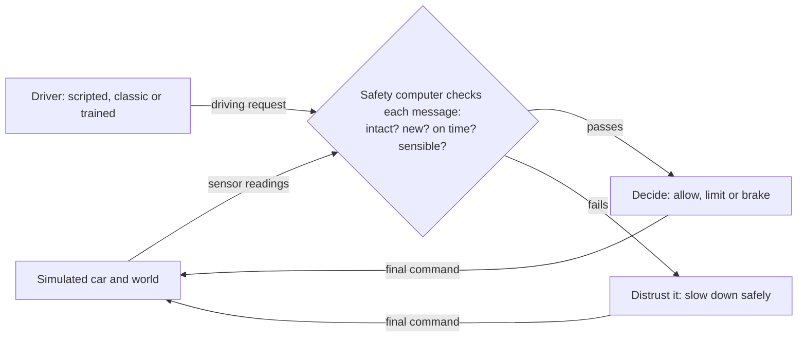

# auto-safety-hil-ecu

A learning project: a simulated car on a PC talks to a real microcontroller over a car network. The microcontroller acts as a safety computer. It checks what it hears and decides when to step in. The simulator is also a place to train driving software, with the safety computer always having the final say.

## How data flows

The driver only asks. The safety computer always decides what the car actually does.

> **Not a real safety system.** This is for learning only. It borrows ideas from car safety engineering, but claims no safety standard, and it controls only a simulated car.

## License
MIT, see [LICENSE](LICENSE). Third-party code keeps its own license.
